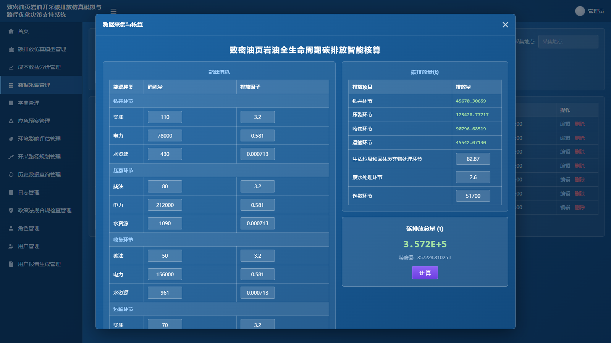
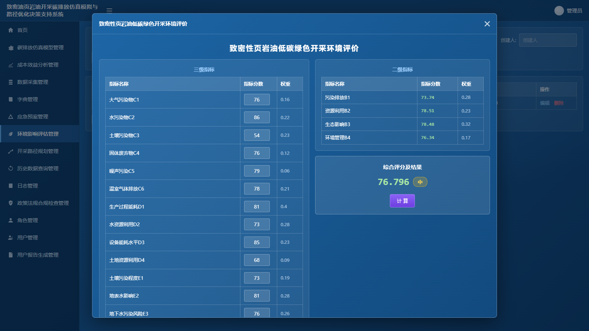
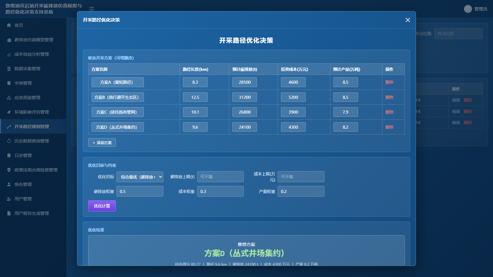
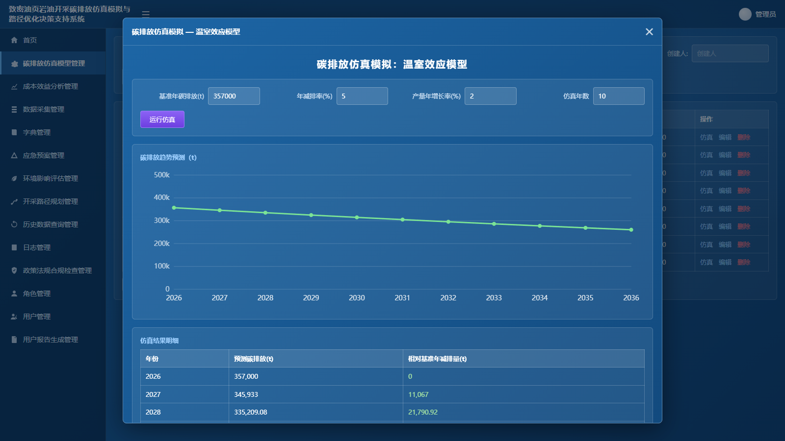
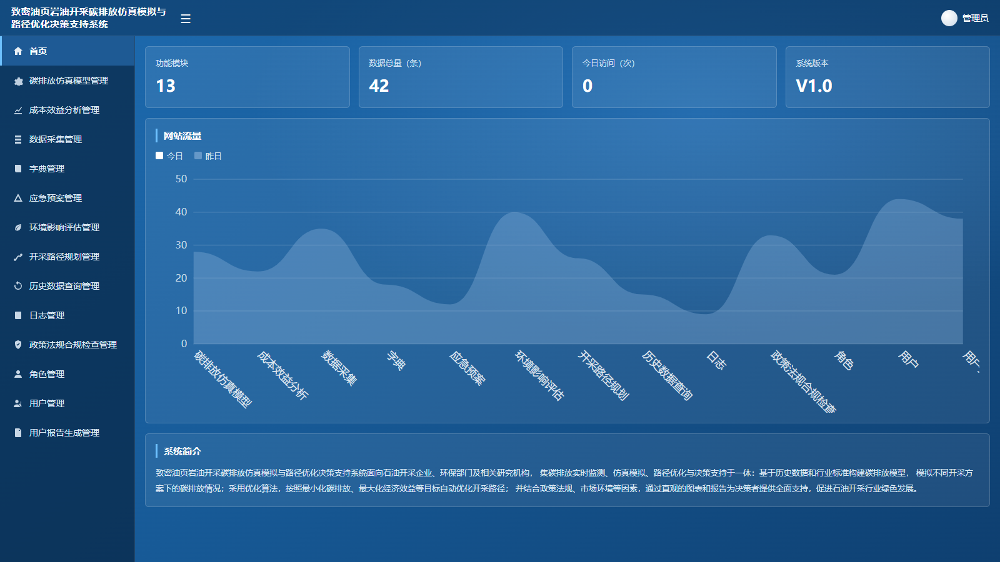
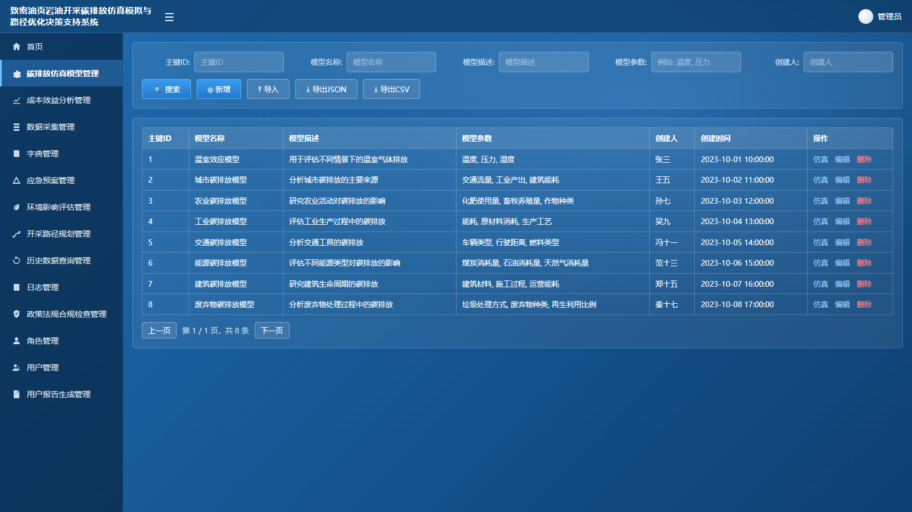

# 致密油页岩油开采碳排放仿真模拟与路径优化决策支持系统 V1.0

面向石油开采企业、环保部门及研究机构的碳排放管理与决策支持工具，集碳排放监测、仿真模拟、路径优化与决策支持于一体。

- **纯前端单文件应用**：全部功能在 `index.html` 一个文件内，无需服务器和数据库
- **数据本地保存**：所有录入数据保存在浏览器 localStorage 中，支持 JSON / CSV 导入导出
- **在线演示**（GitHub Pages）：https://songyang1992.github.io/tightoil-carbon-dss/

## 快速开始

任选其一：

1. **在线使用**：打开上方演示地址
2. **离线使用**：下载本仓库的 `index.html`，双击即可在浏览器中打开使用（无需联网，可U盘拷贝分发）

## 功能模块（13个）

| 模块 | 说明 |
| --- | --- |
| 碳排放仿真模型管理 | 模型的新增/编辑/删除/查询/导入导出，支持一键运行仿真 |
| 成本效益分析管理 | 减排措施成本效益分析记录管理 |
| 数据采集管理 | 采集数据管理 + 内置**全生命周期碳排放智能核算** |
| 字典管理 | 排放因子、能源类型等字典维护 |
| 应急预案管理 | 应急预案的维护与查询 |
| 环境影响评估管理 | 内置**低碳绿色开采环境评价**计算（19项三级指标加权综合评价） |
| 开采路径规划管理 | 路径规划记录 + **多指标路径优化决策模型** |
| 历史数据查询管理 | 历史查询记录管理 |
| 日志管理 | 系统操作日志 |
| 政策法规合规检查管理 | 合规检查记录 |
| 角色管理 / 用户管理 | 权限与账户信息 |
| 用户报告生成管理 | 分析报告编制与归档 |

## 核心计算功能

### 1. 全生命周期碳排放智能核算（数据采集管理 → 碳排放智能核算）

覆盖钻井、压裂、收集、运输四个环节的柴油/电力/水资源消耗（消耗量 × 排放因子），
叠加生活垃圾和固体废弃物处理、废水处理、逸散环节排放量，自动汇总碳排放总量（科学计数法显示）。
核算结果可一键保存为数据采集记录。

### 2. 低碳绿色开采环境评价（环境影响评估管理 → 新增）

录入 19 项三级指标得分（0-100），按既定权重自动计算 4 项二级指标（污染排放、资源利用、生态影响、环境管理）
与综合评分，并给出评级：优（90-100）、良（80-90）、中（70-80）、合格（60-70）、不合格（0-60）。

### 3. 开采路径优化决策（开采路径规划管理 → 路径优化决策）

对候选开采方案按路径长度、预计碳排放、投资成本、预计产量进行归一化加权评分，
支持碳排放最小 / 成本最小 / 产量最大 / 综合最优四种目标，可设定排放与成本约束上限，
自动排序并给出推荐方案与决策建议。

### 4. 碳排放仿真模拟（碳排放仿真模型管理 → 仿真）

基于基准年碳排放、年减排率、产量增长率进行多年情景仿真，输出碳排放趋势曲线与逐年明细。

## 界面预览

| 首页 | 数据管理 |
| --- | --- |
|  |  |

## 技术说明

- 技术栈：React 18 + TypeScript + Vite，构建为单文件静态页面
- 数据持久化：浏览器 localStorage（不同浏览器/设备之间数据不互通）
- 无需登录，开箱即用
